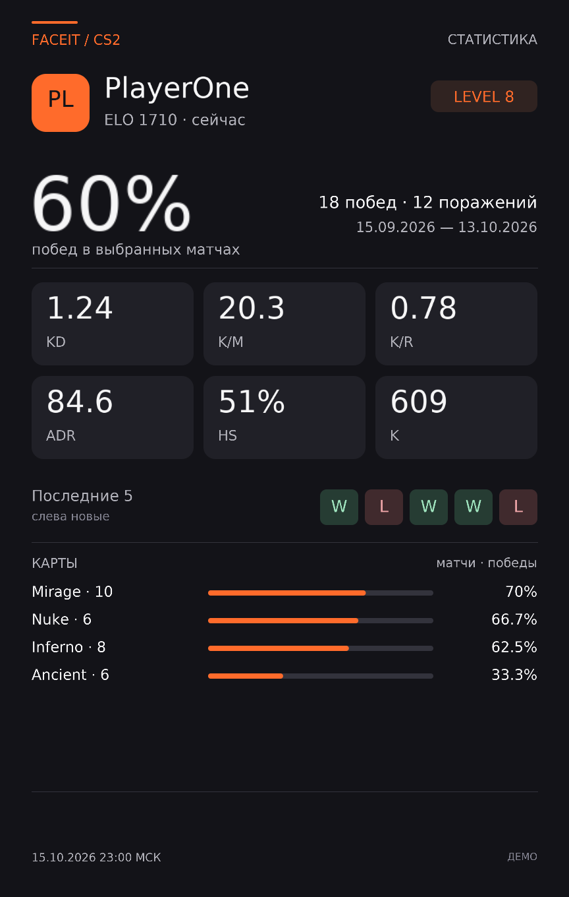
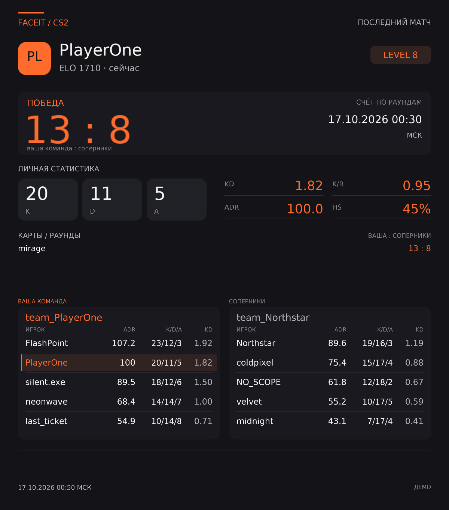

# FACEIT CS2 • Telegram Serverless

Бот для Telegram-групп и супергрупп без списка разрешённых чатов. Основной вариант — JavaScript на Telegram Serverless, без VPS и постоянно включённого компьютера. Пока доступ в листе ожидания, есть временный локальный режим на Mac с Node.js 24 и long polling, без домена и входящих подключений.

**Текущий бот работает в облачной копии Sites; эта папка — локальный резерв.** Заявка Telegram Serverless остаётся в листе ожидания. FACEIT key проверен на профиле `aghori-`: доступны история и подробная статистика матчей. Переключайте доставку только через CLI ниже: polling и webhook нельзя запускать одновременно.

**Начни с [подробной пошаговой инструкции](docs/getting-started-ru.md):** создание приложения и ключа FACEIT, безопасное сохранение ключа на Mac, подготовка бота и запуск после одобрения Serverless.

## Данные для тестирования

- Бот: [road_to_3_elo_bot](https://t.me/road_to_3_elo_bot).
- FACEIT ник: `aghori-` — только тестовый пример, не привязка игрока к чату.
- Telegram: супергруппа с `peer id 4393474895`, Bot API `chat_id = -1004393474895`. Тип и ID подтверждены форматом ссылки на сообщение `https://t.me/c/4393474895/2`; `2` — номер сообщения.
- Это только диагностический пример: бот работает и в других группах/супергруппах после добавления и выдачи прав. Ключи хранятся в защищённых локальных файлах. ID сам по себе не даёт доступа к частному чату.





## Команды и кнопки

| Команда | Действие |
|---|---|
| `/menu`, `/start`, `/help` | Inline-кнопки и помощь; slash-меню регистрируется при вызове |
| `/setup` | ID текущей группы и инструкция настройки |
| `/last [ник]` | FACEIT Dark PNG последнего завершённого CS2 матча: результат, счёт, карты, K/D/A и составы; кнопка со ссылкой |
| `/stats [ник]` | Последние до 30 завершённых матчей: FACEIT Dark только PNG с кнопками с покрытием |
| `/setfaceit ник`, `/setfaceit` | Сохранить или посмотреть свой FACEIT только в текущем чате |
| `/unsetfaceit` | Удалить свою привязку в текущем чате |
| `/poll` | Нативный опрос «Играть сегодня (время по МСК)» |
| `/setts адрес:порт пароль` | Сохранить TeamSpeak **только текущей группы**, администратором |
| `/setts --no-password адрес:порт` | Явно задать TeamSpeak без пароля |
| `/ts` | Выдать TeamSpeak только этой группы |

Команды поддерживают `@имя_бота`. Ник можно сохранить командой `/setfaceit ник`: `/last` и `/stats` без аргумента используют привязку отправителя в этом чате. Явный ник имеет приоритет и не меняет привязку. Кнопки FACEIT запрашивают статистику нажавшего участника; «Мой FACEIT» показывает его настройку. Общего списка участников и совместной статистики нет. [Подробный пользовательский путь](docs/personal-faceit-ru.md). В локальном режиме `/stats` автоматически загружает порции данных и присылает карточку без дополнительного текста без ручного продолжения. Checkpoint сохраняется после каждой порции. В Serverless, при rate limit или исчерпании защитного лимита появляется «Продолжить»: прогресс хранится в SQLite и переживает новый invocation. Продолжение привязано к исходной группе и теме форума.

### Опрос

Варианты в точном порядке: `да, в 17`, `да, в 18`, `да, в 19`, `да, в 20`, `да, в 21`, `да, в 22`, `да, в 23`, `да, позже`, `нет`.

Неанонимный, множественный выбор, переголосование включено. Добавление/перемешивание вариантов, скрытие результатов, quiz, таймер, расписание, авто-закрепление и ограничения голосующих выключены. Прошедшие часы не убираются. Telegram допускает одновременно «нет» и время; бот не меняет нативные правила и не хранит голоса.

## Что сделать сейчас

На этом Mac уже установлены Node.js `24.22.0` и npm/npx `11.19.1`. Шаг получения FACEIT key выполнен, его реальный доступ проверен. Сейчас ожидаем одобрения Telegram Serverless; до него не выполнять login/deploy.

1. Создать FACEIT приложение в [Developer Portal](https://developers.faceit.com/), затем ключ типа **Server side**: подробные шаги и предлагаемые значения полей — [в инструкции](docs/getting-started-ru.md).
2. Сохранить ключ в `/Users/busygind02/IdeaProject/faceit-telegram-bot/.secrets/faceit.key` с правами `0600`. Сам ключ в переписку не отправлять — сообщить только путь. Инструкция содержит способ записи через буфер обмена без значения ключа в истории команд.
3. Подготовить тестовую группу: добавить `@road_to_3_elo_bot` и выдать нужные права. Локальный runner позволяет тестировать команды, пока Serverless в листе ожидания.
4. Дождаться доступа. Только после одобрения получить **Serverless → CLI Access → Access token** и перейти к публикации.

API key FACEIT, Telegram Bot API token и Serverless CLI token — разные секреты. Облачному runtime SDK отдельный Bot API token не нужен; локальный runner читает его из защищённого файла; нужен FACEIT key, а для публикации — отдельный CLI token. Приложение FACEIT — запись проекта для ключей API, не второй Telegram-бот и не мобильное приложение.

## Переключение локальной и облачной копий

Для текущего бота на Sites и резервной копии на Mac добавлена операторская CLI:

```bash
cd ~/IdeaProject/faceit-telegram-bot
./bot status
./bot cloud
./bot local
```

Выбери **одну** команду переключения, а не запускай их последовательно. `cloud` сначала проверяет облако и секрет, потом останавливает проверенный локальный процесс и включает webhook. `local` сохраняет очередь, отключает наш webhook, ждёт защитные 150 секунд и запускает локальный процесс в фоне. [Подробности, ограничения и восстановление](docs/switching-local-sites-ru.md). Базы и настройки TS между средами не синхронизируются.

## Кеш `/last` и `/stats`

В локальном runner готовые отчёты и Telegram `file_id` хранятся в SQLite; в копии Sites — в D1. Они переживают новый процесс/Worker invocation, но между локальной и облачной БД не синхронизируются. Перед каждым поиском в кеше бот заново читает профиль и полностью выбирает актуальные последние матчи из истории FACEIT.

- Полный отчёт свежий **5 минут**, неполный — **1 минуту** от его первоначальной генерации; повторные запросы срок не продлевают.
- Новый матч, изменения выбранных матчей, ника, текущих ELO/уровня, ключей или версии шаблона исключают прежний кеш.
- При совпадении бот не перечитывает подробности 30 матчей, не пересчитывает и не рисует картинку, а отправляет сохранённый Telegram `file_id`. Подтверждённо недействительный `file_id` заменяется новой загрузкой; неоднозначная отправка вслепую не повторяется.
- Первый запрос, новый матч и истечение срока всё ещё требуют загрузки данных. Повтор не мгновенный: остаются свежие запросы FACEIT, проверки доступа, БД и доставка Telegram.
- Ошибка кеша не блокирует обычный расчёт. До 256 отчётов на БД; просроченные записи удаляются при записи. Ни сообщения чата, ни пароль TeamSpeak в этом кеше не хранятся.

Кеш подключён к локальному runner и Sites. Адаптер Telegram Serverless пока не использует этот отдельный постоянный кеш.

## Временный запуск на Mac уже сейчас

Токен BotFather сохранён в `.secrets/telegram-bot.token`, FACEIT key — в `.secrets/faceit.key`. Сами значения в терминале и переписке не печатать. Установка npm-зависимостей локальному runner не нужна.

```bash
export PATH="/Users/busygind02/.local/bin:$PATH"
cd /Users/busygind02/IdeaProject/faceit-telegram-bot
npm run local:check
npm run local
```

Проверка только читает настройки Telegram: имя бота и отсутствие webhook. Только у `npm run local:check` можно передать необязательный `--chat-id` для проверки доступа и прав в конкретной группе; это не ограничивает рабочие чаты. Обычный запуск `npm run local` и переключение `./bot local` выполняются без chat ID. Запуск создаёт локальную закрытую SQLite и отдельный ключ шифрования TS. Он **не удаляет webhook** и не меняет облачную конфигурацию. Должен работать только один polling-процесс.

После запуска отправь `/menu@road_to_3_elo_bot` в тестовую группу. Для остановки — `Ctrl+C` в терминале запуска. Mac должен быть включён, не спать и иметь интернет; это не круглосуточный сервер Codex. Подробная [инструкция локального тестирования](docs/local-testing-ru.md) включает ошибки, команды и переход в Serverless. Перед `webhook sync` останови локальный процесс. Локальные данные не переносятся в облако автоматически.

## Запуск после одобрения Serverless

Локально нужен Node.js 24 и npm. Если `node --version` или `npm --version` не работают, сначала установи Node.js 24 LTS с [официального сайта](https://nodejs.org/en/download) и заново открой терминал. `nvm install` нужен только при уже установленном nvm; это не обязательный первый шаг.

Из каталога проекта:

```bash
cd /Users/busygind02/IdeaProject/faceit-telegram-bot
npm ci
npm test
npm run check
npx tgcloud login
```

На `login` вводится **Serverless CLI Access token**, не FACEIT key и не Telegram Bot API token. После этого:

```bash
npm run configure -- --faceit-key-file /Users/busygind02/IdeaProject/faceit-telegram-bot/.secrets/faceit.key
npm run deploy -- --dry-run
npm run deploy
npx tgcloud migrate --dry-run
npx tgcloud migrate
npx tgcloud webhook sync
npx tgcloud webhook
```

`deploy --dry-run` выполняет локальную проверку без загрузки. Обычный `deploy` публикует код, `migrate` отдельно создаёт/обновляет таблицы после просмотра плана, `webhook sync` включает доставку updates. До завершения всех шагов не проверять бота вводом настоящего TS пароля. Не использовать `push --force` и `migrate --yes` без разбора изменений.

`configure` не требует chat ID или bootstrap-режима: после публикации бот доступен в любой группе/супергруппе, куда его добавили и выдали права. `/setup` в нужном чате показывает его ID для диагностики, а не включает доступ. Повторный `configure` сохраняет существующий encryption key; его файл нельзя удалять после настройки TS.

### Путь участника

1. Добавить бота в любую группу или супергруппу; выдать права администратора для надёжной проверки членства и право удаления команд с TS-паролем, разрешить сообщения/фото/опросы. Рабочие команды в личке и каналах не поддерживаются.
2. `/menu` → администратор отправляет `/setts ts.example.org:9987 пароль с пробелами` прямо в группе.
3. `/ts` → реквизиты этой группы. В другой группе они не появятся; пароль команды не повторяется в подтверждении.
4. `/poll` → открытый множественный опрос.
5. `/last@road_to_3_elo_bot aghori-` → карточка последнего завершённого матча и кнопка со ссылкой.
6. `/stats@road_to_3_elo_bot aghori-` → при необходимости «Продолжить» → только карточка.
7. `/setfaceit aghori-` → `/last` и `/stats` без аргумента используют личную привязку только этого чата; в другом чате её задают отдельно.

Пароль в команде виден группе и Telegram. После сохранения бот пытается удалить исходное сообщение; при неудаче сообщает об этом, не отменяя сохранение. Удаление не удаляет уведомления/скриншоты/пересылки. Пароль — весь остаток после адреса, включая внутренние пробелы. Приватные, пересланные, отредактированные и анонимные административные сообщения настройки не принимаются.

## Данные и ограничения

Бота можно добавлять в новые группы без изменения конфигурации и повторной публикации. Проверки членства и административных прав сохраняются: открытый доступ не даёт читать чужие настройки TeamSpeak или изменять чужую FACEIT-привязку. Новые группы используют общий FACEIT key и ресурсы хостинга. Ограничения заданий и обработка rate limit ограничивают отдельный запрос, но не гарантируют общую квоту и одинаковую скорость при росте числа чатов.

- Встроенная SQLite: зашифрованные TeamSpeak настройки по `chat_id`, технические delivery tombstones и публичные FACEIT checkpoints. Никаких сырых Telegram updates, паролей plaintext и списков голосовавших.
- TeamSpeak: AES-256-GCM-SIV из vendored noble-ciphers; AAD привязан к `chat_id`. Ключ вне базы. Миграция group → supergroup атомарно переносит запись и прекращает доступ по старому ID. Тему форума TS не разделяет: настройки общие для всей группы.
- FACEIT history: явные timestamps в секундах, полное чтение окна 90 дней, расширение назад, деление насыщенных окон, дедупликация, выбор 1/30 по `finished_at`. Последний месяц не является пределом. При задержке stats остаётся настоящий последний матч, а не подстановка старого.
- Один активный тяжёлый расчёт на группу; в Serverless по умолчанию до 8 GET за порцию; локально — 4 GET с автоматическим продолжением до 32 порций, последовательно. Автопродолжение проверяет 90-секундный мягкий лимит между порциями; один уже начатый batch может завершиться позже. Это наши защитные настройки, не заявленные квоты FACEIT. 429/5xx/сетевая ошибка сохраняет `retryAt` и останавливает автопродолжение; продолжение — кнопкой после указанного ожидания, без фонового scheduler.
- Checkpoint сохраняется **между порциями**. Если среда принудительно прервёт invocation посреди порции, недосохранённые GET могут повториться: это безопасные GET. Фактический лимит исполнения Serverless не опубликован в изученной документации.
- Отправки Telegram не повторяются автоматически при неизвестном результате. После обрыва между reservation и POST возможна недоставка: не обещается exactly-once. Новая явная команда создаёт новый запрос. Новая `/poll` не ограничена одним опросом в день.
- Технические reports хранятся 7 дней, delivery tombstones — 30 дней. Очистка выполняется по запросам бота, не по несуществующему фоновому cron. Настройки TS автоматически не удаляются.
- Слишком плотная неделимая история завершает запрос с объяснением: бот не выдаёт заведомо неполный поиск за точные «последние 30».

### Формулы

K/D = сумма убийств / сумма смертей; K/R = сумма убийств / сумма раундов. Для каждой метрики используются только карты с обоими операндами; покрытие показано отдельно. Средние убийства считаются по матчам с полными убийствами на всех сыгранных картах; BO3 считается одним матчем. HS = сумма headshot kills / сумма kills, ADR = сумма damage / сумма rounds. Если есть только ADR карты, используется взвешенное по раундам приближение с пометкой. Win rate учитывает только известные исходы. Пропуски и деление на ноль — `—`, не `0`. ELO/уровень — **сейчас**, не изменение за выборку.

## Безопасность конфигурации

Serverless reference не документирует отдельное хранилище секретов/env. Поэтому `configure` генерирует серверный `tgcloud/lib/private-settings.js` из локального защищённого `.secrets/runtime.json`. Оба исключены из Git и имеют `0600`; `.secrets` — `0700`. Private JS **деплоится в серверную библиотеку**, а не публикуется как Mini App/страница.

**Это не Vault:** владелец CLI/BotFather и любой, кому вы дали доступ к исходникам облака, может прочитать ключи. Шифрование базы не защищает от компрометации кода и ключа вместе. Не запускайте `tgcloud diff/pull/reset` с выводом секретного модуля на общий экран/в CI-лог. Не добавляйте private module принудительно в Git. Отдельный secret store платформы нельзя обещать без подтверждения её возможностей.

Сделайте отдельную зашифрованную резервную копию `.secrets/runtime.json` вне проекта. Не удаляйте и не генерируйте заново encryption key после настройки TS: прежние записи станут нечитаемыми. Подробности: [развёртывание](docs/deployment.md), [приёмка](docs/acceptance.md), [FACEIT API](docs/api-contract.md), [криптография](docs/crypto-provenance.md).

## Разработка

```bash
npm test
npm run check
npm run demo
npm run deploy -- --dry-run
```

Тесты используют `node:test`, локальную SQLite in-memory и синтетические ответы API. Не используют реальные ключи или сеть и очищают временные файлы. `demo` — прямой визуальный артефакт, не промежуточный файл. В облачном runtime нет npm-пакетов, файловой системы, Node Buffer, таймеров или зависимости от WebCrypto; локальный runner использует встроенные Node.js fetch/SQLite/таймеры/файлы; зависимости в package-lock нужны только CLI/воспроизводимой сборке. Код рендера и vendor уже включены.

## Быстродействие и формат FACEIT-ответов

Подтверждённый шаблон — FACEIT Dark. `/last` и `/stats` отвечают только изображениями, без подписей, текстовых отчётов и сообщений о загрузке. Ошибки, подсказки и сохранённый прогресс тоже оформлены как PNG с кнопками. Если Telegram отклонил фото или результат POST неизвестен, текстовый fallback и автоматический повтор не выполняются. TeamSpeak, меню и опросы не менялись.

Временный локальный runner дополнительно сжимает PNG без потери пикселей: около 110–120 КБ вместо 3,53 МБ на наших примерах. Ограниченный RAM-кэш завершённых матчей действует 5 минут, до 256 записей/16 МБ. Профиль и история каждый раз читаются заново: новый матч не теряется, ELO обновляется. Ошибки, пустая статистика и незавершённые матчи не кэшируются. Кэш очищается при перезапуске. Для Telegram Serverless эти Node-адаптеры не подключены.

Замер холодного `/stats aghori-`: 63 GET FACEIT, 14,17 с загрузки, 77 мс отрисовки. Ожидание связано прежде всего с API и отправкой большого файла, а не со сложным вычислением картинки. Первый запрос по новому игроку по-прежнему требует сетевой загрузки; повторные запросы в пределах TTL читают совпавшие завершённые матчи из RAM-кэша.

## Минималистичные карточки

`/last` — широкая карточка 1200×1360, ADR добавлен в составы. Игроки каждой команды отсортированы по ADR по убыванию, отсутствующий ADR — в конце; при равных значениях сохраняется порядок источника. Запрошенный игрок остаётся выделенным.

`/stats` — 864×1360, карты отсортированы по винрейту по убыванию. Подписи: KD, K/M, K/R, ADR, HS, K. Убраны повторяющиеся счётчики покрытия, названия шаблона и API, пояснения о подсветке и технические подписи. Даты, значимые предупреждения о неполных данных и ADR ≈ сохранены; сортировки не меняют исходный отчёт или формулы.
